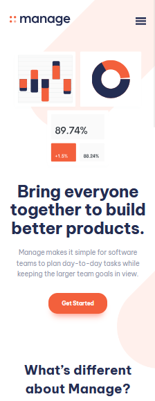
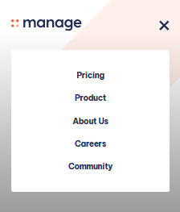
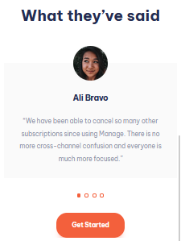
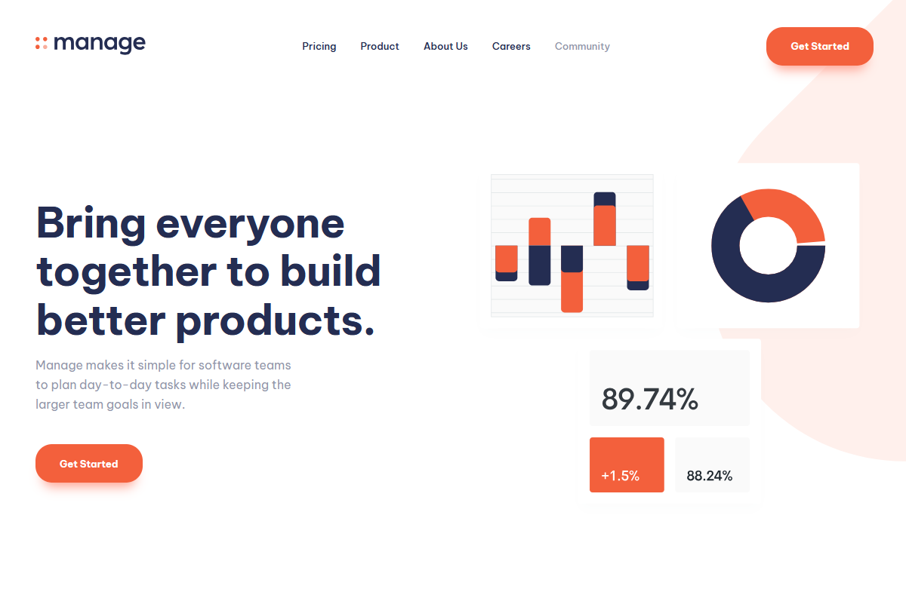

# Frontend Mentor - Manage landing page solution

This is a solution to the [Manage landing page challenge on Frontend Mentor](https://www.frontendmentor.io/challenges/manage-landing-page-SLXqC6P5). Frontend Mentor challenges help you improve your coding skills by building realistic projects.

## Table of contents

- [Overview](#overview)
  - [The challenge](#the-challenge)
  - [Features](#features)
  - [Screenshot](#screenshot)
  - [Links](#links)
  - [Running locally](#running-locally)
  - [Project structure](#project-structure)
- [My process](#my-process)
  - [Built with](#built-with)
  - [What I learned](#what-i-learned)
  - [Continued development](#continued-development)
  - [Useful resources](#useful-resources)
- [Author](#author)
- [Acknowledgments](#acknowledgments)

## Overview

### The challenge

Users should be able to:

- View the optimal layout for the site depending on their device's screen size
- See hover and focus states for all interactive elements on the page
- See all testimonials in a horizontal slider
- Receive an error message when the newsletter sign-up form is submitted if the email address is empty or not formatted correctly

### Features

- **Fully responsive** – the layout adapts across phone, tablet (`md`) and desktop (`xl`) breakpoints, including re-ordered hero content, re-flowed feature cards and a re-arranged footer grid.
- **Mobile menu** – a hamburger button opens a slide-in menu over a dark gradient overlay. It closes with the close icon, a click on the overlay, or the <kbd>Esc</kbd> key; page scrolling is locked while it's open, and the toggle has `aria-label` and `aria-expanded` attributes.
- **Numbered feature list** – "What's different about Manage?" renders three numbered cards from `feature.js`.
- **Testimonial slider** – four testimonials from `testimonial.js`. On smaller screens one card is shown at a time, with clickable dots and touch-swipe navigation; from `xl` the cards are laid out side by side.
- **Newsletter form** – an email field in the footer with pattern validation. An invalid address gets a red outline and a "Please insert a valid email" message, with no extra JavaScript state.
- **Hover states** – buttons (orange and white variants), navigation links, footer links and social icons all react on hover.
- **Reusable components** – `Button`, `List`, `FeatureCard` and `TestimonialCard` are shared across sections.

### Screenshot







### Links

- Solution URL: [GitHub](https://github.com/AristarhMD/Manage-Landing-Page)
- Live Site URL: [Netlify](https://manage-landing-page-vn.netlify.app/)

### Running locally

```bash
# install dependencies
npm install

# start the dev server
npm run dev

# lint the code
npm run lint

# create a production build in dist/
npm run build

# preview the production build
npm run preview
```

### Project structure

```
├── index.html
├── index.css                      # Tailwind import, theme tokens, text presets, custom utilities
├── vite.config.js
├── eslint.config.js
├── package.json
├── public
│   └── images                     # Testimonial avatars and background patterns
├── screenshots                    # Images used in this README
└── src
    ├── main.jsx                   # App entry point
    ├── feature.js                 # Data for the numbered feature cards
    ├── testimonial.js             # Data for the testimonial slider
    ├── assets                     # Logo, icons and hero illustration
    └── components
        ├── App.jsx                # Navigation + Main + Footer
        ├── Navigation.jsx         # Logo, desktop nav, mobile menu
        ├── Main.jsx               # Hero, features, testimonials and CTA banner
        ├── Carousel.jsx           # Testimonial slider (dots + swipe)
        ├── Footer.jsx             # Newsletter form, links, social icons
        └── reusable
            ├── Button.jsx
            ├── FeatureCard.jsx
            ├── List.jsx           # Link list styled through props
            └── TestimomialCard.jsx
```

## My process

### Built with

- Semantic HTML5 markup
- [React 19](https://react.dev/) - JS library
- [Vite](https://vite.dev/) - Dev server and build tool
- [Tailwind CSS v4](https://tailwindcss.com/) (via `@tailwindcss/vite`) - Utility-first styling with design tokens defined in CSS
- CSS Grid
- Flexbox
- Mobile-first workflow
- [ESLint](https://eslint.org/) - Flat config with the React Hooks and React Refresh rules
- [Be Vietnam Pro](https://fonts.google.com/specimen/Be+Vietnam+Pro) - Typeface from Google Fonts

### What I learned

**Design tokens and reusable utilities in Tailwind v4.** Colours, custom shadows, a gradient and the font are declared once in an `@theme` block. Repeated patterns, like the orange call-to-action button, become custom utilities built from those tokens, so a component only needs `style="orangeBtn"`:

```css
@theme {
  --color-orange-400: #f3603c;
  --shadow-orangebtn: 0 15px 15px -10px #ff9f8e;
  --background-image-gradient-1: linear-gradient(#00000000 0%, #000 100%);
  --font-sans: "Be Vietnam Pro", sans-serif;
}

@utility orangeBtn {
  @apply cursor-pointer bg-orange-400 preset-5-b text-white shadow-orangebtn hover:bg-orange-350 rounded-[22px] px-8 py-4;
}
```

**Styling the same component in different places with props.** `List` renders a list of links and receives its container and item classes as props, so one component handles the mobile menu, the desktop navigation and the footer links:

```jsx
<List
  list={["Pricing", "Product", "About Us", "Careers", "Community"]}
  listStyle="flex flex-col justify-center items-center gap-6"
  itemStyle="mobNavItem"
/>

<List
  list={["Pricing", "Product", "About Us", "Careers", "Community"]}
  listStyle="hidden invisible xl:flex xl:visible justify-center items-center gap-8"
  itemStyle="deskNavItem"
/>
```

**Form validation with CSS only.** Marking the input as a `peer` lets the error message react to the input's `:invalid` state. Combining `invalid:` with `not-placeholder-shown:` keeps the red outline from appearing before the user has typed anything:

```jsx
<input
  type="email"
  placeholder="..."
  pattern="[a-zA-Z0-9._%+\-]+@[a-zA-Z0-9.\-]+\.[a-zA-Z]{2,}"
  className="peer inputEmail"
/>
<p className="invisible peer-invalid:visible preset-6 text-red-500">
  Please insert a valid email
</p>
```

```css
@utility inputEmail {
  @apply ... invalid:not-placeholder-shown:ring-1 invalid:not-placeholder-shown:ring-inset invalid:not-placeholder-shown:ring-red-500;
}
```

**A mobile menu that behaves like a real one.** `useEffect` locks the page scroll while the menu is open, and its cleanup function restores it, even if the component unmounts. The same pattern is used for closing the menu with <kbd>Esc</kbd>:

```jsx
useEffect(() => {
  document.body.style.overflow = isOpen ? "hidden" : "";
  return () => {
    document.body.style.overflow = "";
  };
}, [isOpen]);
```

**One slider, two behaviours.** The carousel keeps a single `currentIndx` state. Each card is only displayed when it's the current one, except from `xl` upward, where `xl:flex` shows them all side by side and the dots are hidden:

```jsx
<div className={`... ${current ? "flex" : "hidden"} xl:flex flex-col items-center`}>
```

**Re-flowing a grid across breakpoints.** The footer links use `grid-flow-col` and change the number of rows and columns at each breakpoint (2 × 4 on mobile, 4 × 2 on tablet, 2 × 4 on desktop), so the same list is laid out differently without duplicating any markup.

**Decorative backgrounds with pseudo-elements.** The background shapes from the design are placed with `after:` utilities on `#root` and `<main>`, positioned per breakpoint and sent behind the content with a negative `z-index`.

### Continued development

- **Accessibility**
  - The slider dots are `<span>` elements with a click handler. They should be `<button>`s with `aria-label`s and an `aria-current` state.
  - The social links have no accessible names and use `target="_blank"` without `rel="noopener noreferrer"`.
  - `mobListRef.current?.focus()` is called on a `div` without `tabIndex`, so focus doesn't actually move into the menu.
  - Add explicit `focus-visible` styles to buttons and links, as the challenge asks for focus states.
- **Cleanup**
  - Extract a `Logo` component – the logo SVG is duplicated in `Navigation.jsx` and `Footer.jsx` with different fills.
  - Rename `TestimomialCard.jsx` to `TestimonialCard.jsx`.
  - Fix the placeholder typo ("Updats in you inbox...").
  - Remove the unused SVG files in `src/assets` (the icons are inlined in the components).
  - Drop the redundant `xl:invisible` where `xl:hidden` is already applied.

### Useful resources

- [React documentation](https://react.dev/) - Reference for hooks, effects and their cleanup functions.
- [Tailwind CSS documentation](https://tailwindcss.com/docs) - Covers the v4 CSS-first setup with `@theme` and `@utility`.
- [Tailwind CSS: hover, focus and other states](https://tailwindcss.com/docs/hover-focus-and-other-states) - Explains `group`, `peer`, `invalid:` and the other state variants used here.
- [Vite guide](https://vite.dev/guide/) - Project setup, static assets and building for production.

## Author

- GitHub - [@AristarhMD](https://github.com/AristarhMD)
- Frontend Mentor - [@AristarhMD](https://www.frontendmentor.io/profile/AristarhMD)
- LinkedIn - [@Victor](https://www.linkedin.com/in/victor-nani-4b7a13179/)

## Acknowledgments

Thanks to [Frontend Mentor](https://www.frontendmentor.io) for the challenge, the design and the starter assets.
